> **这篇文章写给谁**：已经学过这部分、理解原理，但做题时觉得公式和结论又多又乱的人。目的是把课本里零散的内容理成一条线，方便归纳。
>
> - **不适合零基础**：这里不推导、不讲原理，第一次学请先看课本。
> - **不适合查漏补缺**：只整理了做题最常用的部分，没法用来检查自己漏了哪些知识点。
> - **不可能包括所有知识点**，完整内容以课本为准。
>
> 本笔记由 Claude 独家识别、整理并推送 😄

> 本文整理自我的手写笔记。符号约定：小写 \(v_{GS}\)、\(i_D\) 表示**瞬时总量**，大写带 Q 的 \(V_{GSQ}\)、\(I_{DQ}\) 表示**静态工作点**的值；开启电压统一写作 \(V_{TN}\)。笔记和课本里的 \(V_{thn}\)、\(U_{thn}\)、\(U_{th}\) 都是同一个意思，指的都是开启电压。

## 一、增强型 N 沟道 MOS 管

### 1. 符号与结构

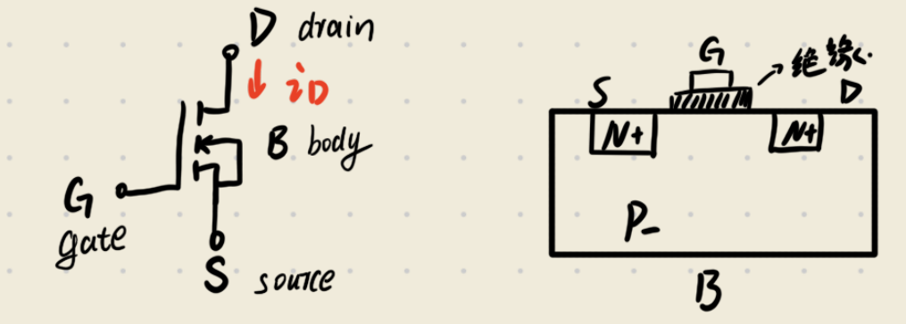

四个电极：

| 电极 | 英文 | 含义 |
| --- | --- | --- |
| G | gate | 栅极，与沟道之间隔着一层绝缘层 |
| D | drain | 漏极，接 N+ 区 |
| S | source | 源极，接 N+ 区 |
| B | body | 衬底（P 型），通常与 S 相连 |

### 2. 基本特点

- 栅极被绝缘层隔开，所以栅极电流几乎为零：\(i_G \approx 0\)。
- 由 \(v_{GS}\) **控制** \(i_D\)，是一种**电压控制**器件。
- 由于 \(i_G \approx 0\)，流进漏极的电流全部从源极流出：\(i_D = i_S\)。

## 二、输出特性：三个工作区

> 适用于共源接法。

输出特性描述的是**固定输入 \(v_{GS}\)，看输出电压 \(v_{DS}\) 对电流 \(i_D\) 的影响**：

$$
i_D = f(v_{DS})\big|_{v_{GS}=\text{常数}}
$$

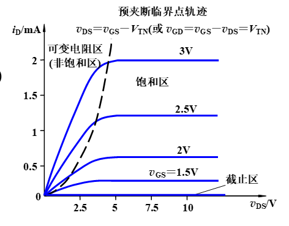

### 1. 截止区

$$
v_{GS} < V_{TN}
$$

还没有形成导电沟道，\(i_D = 0\)。

### 2. 可变电阻区

条件：

$$
v_{GS} > V_{TN}, \qquad v_{DS} < v_{GS} - V_{TN}
$$

此时（\(v_{DS}\) 很小时）

$$
i_D \approx 2K_n (v_{GS} - V_{TN})\, v_{DS}
$$

\(i_D\) 与 \(v_{DS}\) 近似成正比，管子相当于一个**受 \(v_{GS}\) 控制的电阻**：

$$
r_{dso} = \frac{1}{2K_n (v_{GS} - V_{TN})}
$$

其中电导常数

$$
K_n = \frac{\mu_n C_{ox}}{2}\cdot\frac{W}{L} \qquad (\text{单位 } \mathrm{mA/V^2})
$$

### 3. 饱和区（放大区）

条件：

$$
v_{GS} > V_{TN}, \qquad v_{DS} > v_{GS} - V_{TN}
$$

此时 \(i_D\) 基本不随 \(v_{DS}\) 变化，只由 \(v_{GS}\) 决定：

$$
i_D = K_n (v_{GS} - V_{TN})^2 = I_{DO}\left(\frac{v_{GS}}{V_{TN}} - 1\right)^2
$$

其中 \(I_{DO}\) 是 \(v_{GS} = 2V_{TN}\) 时的 \(i_D\)（代进去就能验证：\(I_{DO} = K_n V_{TN}^2\)）。

> 放大电路要正常工作，管子必须在**饱和区**。注意 MOS 管的“饱和区”对应的是三极管的“放大区”，名字容易搞混。

### 4. 考虑沟道长度调制效应（\(\lambda \neq 0\)）

实际饱和区的曲线会稍微向上倾斜，用 \(\lambda\) 修正：

$$
i_D = K_n (v_{GS} - V_{TN})^2 (1 + \lambda v_{DS})
$$

（一般计算时不乘 \(1 + \lambda v_{DS}\)。）由此得到输出电阻和低频互导：

$$
r_{ds} = \frac{1}{\lambda I_D}, \qquad g_m = 2K_n (v_{GS} - V_{TN})
$$

## 三、转移特性

> 适用于共源接法。

转移特性描述的是**固定输出电压 \(v_{DS}\)，看输入电压 \(v_{GS}\) 对输出电流 \(i_D\) 的影响**：

$$
i_D = f(v_{GS})\big|_{v_{DS}=\text{常数}}
$$

### 1. 增强型

在饱和区就是一条二次函数曲线，从 \(v_{GS} = V_{TN}\) 处开始上升：

$$
i_D = K_n (v_{GS} - V_{TN})^2
$$

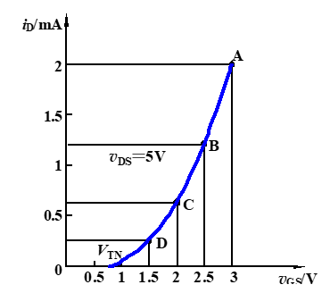

### 2. 耗尽型

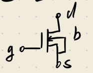

耗尽型管子在 \(v_{GS} = 0\) 时就已经有导电沟道。两个关键参数：

- \(V_{PN}\)：**夹断电压**，\(v_{GS}\) 降到它时沟道消失，\(i_D = 0\)；
- \(I_{DSS}\)：\(v_{GS} = 0\) 时的 \(i_D\)。

$$
i_D = I_{DSS}\left(1 - \frac{v_{GS}}{V_{PN}}\right)^2
$$

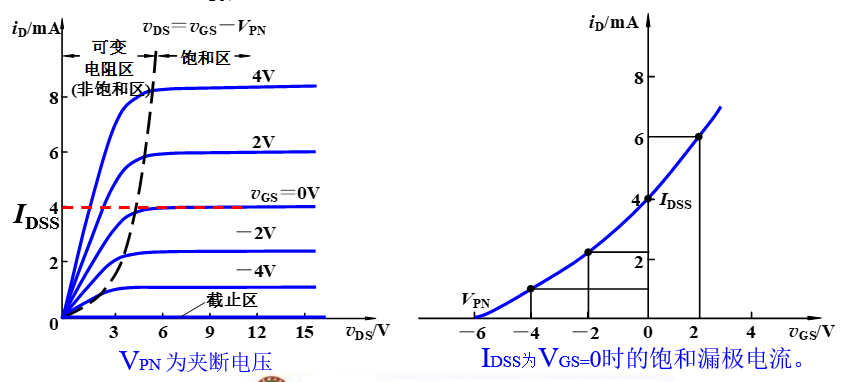

## 四、P 沟道 MOS 管

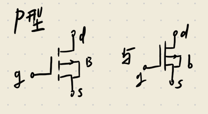

P 沟道管与 N 沟道管的结构、公式一一对应，区别在于**电压、电流方向都反过来**：符号中衬底箭头方向相反，**特性曲线与 N 型关于原点对称**。

## 五、计算题整理

> 本节方法对三种组态都通用（个别例外在对应小标题下注明）。

### 1. 静态工作点：求 \(I_{DQ}\)、\(V_{DSQ}\)、\(V_{GSQ}\)

1. 画**直流通路**；
2. 联立饱和区方程 \(I_{DQ} = K_n (V_{GSQ} - V_{TN})^2\) 和电路中的其他式子（KVL 等）；
3. 解出来之后**检验是否满足饱和区条件**：

$$
V_{GSQ} > V_{TN}, \qquad V_{DSQ} > V_{GSQ} - V_{TN}
$$

4. 若不满足，说明管子在可变电阻区，改用

$$
I_{DQ} = 2K_n (V_{GSQ} - V_{TN})\, V_{DSQ}
$$

5. 不考虑  \({\lambda \neq 0}\) 的情况
### 2. 动态分析

先画**交流通路**。

#### ① 最大不失真输出电压（峰峰值）

> 仅适用于共源：公式由共源电路的输出特性推出，输出电压就是 \(v_{DS}\) 的变化；共漏从源极输出，不能直接套用。

$$
U_{pp} = 2\min\left\{\, V_{DSQ} - (V_{GSQ} - V_{TN}),\ I_{DQ} R_L' \,\right\}
$$

两项分别对应：往左碰到可变电阻区边界的余量，以及往下碰到截止区（\(i_D = 0\)）的余量，取较小的那个再乘 2。\(R_L'\) 是交流通路中漏极看出去的等效负载，交流负载线斜率为 \(-1/R_L'\)。

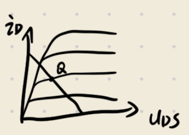

#### ② 小信号模型

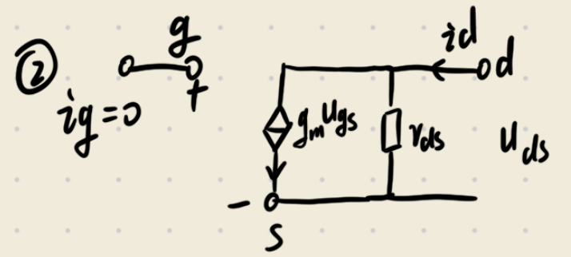

栅极电流 \(i_g = 0\)，所以栅源之间开路；漏源之间是一个受控电流源 \(g_m v_{gs}\) 与 \(r_{ds}\) 并联。参数：

| | 增强型 | 耗尽型 |
| --- | --- | --- |
| 互导 \(g_m\) | \(2K_n (V_{GSQ} - V_{TN})\) | \(\dfrac{2\sqrt{I_{DSS} I_{DQ}}}{\lvert V_{PN} \rvert}\) |
| 输出电阻 \(r_{ds}\) | \(\dfrac{1}{\lambda I_{DQ}}\) | \(\dfrac{1}{\lambda I_{DQ}}\) |

P 型管也一样套用，但算出来的 \(g_m\) 也得是个**正数**。

#### ③ 电压增益与输入、输出电阻

$$
A_u = \frac{U_o}{U_i}
$$

考虑信号源内阻 \(R_{si}\) 时的源电压增益：

$$
A_{us} = \frac{U_o}{U_s} = \frac{U_o}{U_i}\cdot\frac{U_i}{U_s} = A_u \cdot \frac{R_i}{R_i + R_{si}}
$$

- 输入电阻 \(R_i\)：**不管信号源内阻**；
- 输出电阻 \(R_o\)：**不管负载**。
- \({\lambda \neq 0}\) 时，电压增益与输入、输出电阻都要考虑 \(r_{ds}\)

## 六、三种基本组态

判断方法：**把直流电源置零，看 \(U_i\) 从哪个极输入、\(U_o\) 从哪个极输出，剩下那个就是“共”的极。**

### 1. 共源

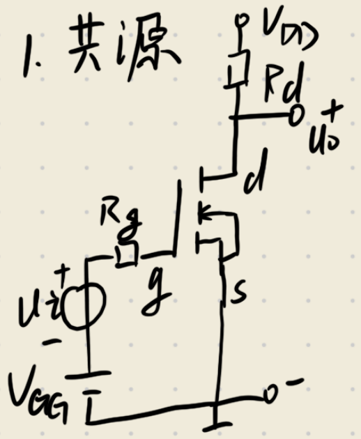

- \(A_u < 0\)：有一定放大能力，输入输出电压**反相**；
- 输入电阻很大；
- 输出电阻约为 \(R_d\)。

### 2. 共漏（源极跟随器）

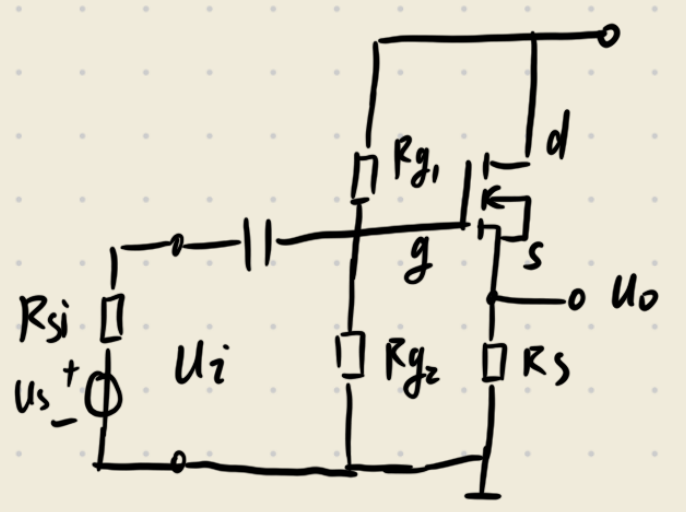

- \(A_u \le 1\)，且 \(A_u \approx 1\)，输入输出**同相**；
- 输出电阻较小；
- \(R_i\) 很大。

### 3. 共栅

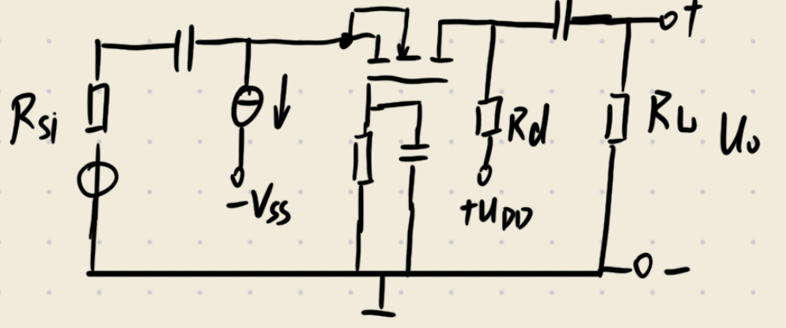

- 输入输出**同相**；
- 增益大小与共源相近，只是相位相同；
- \(R_i\) 小于其他两种组态；
- 输出电阻约为 \(R_d\)（与共源相同）。

### 小结：三种组态定性对比

| 组态 | 电压增益 | 相位 | 输入电阻 | 输出电阻 | 典型用途 |
| --- | --- | --- | --- | --- | --- |
| 共源 | 较大 | 反相 | 很大 | 约为 \(R_d\)，较大 | 电压放大 |
| 共漏 | \(\le 1\)，约为 1 | 同相 | 很大 | 小 | 缓冲、阻抗变换（常作输入级或输出级） |
| 共栅 | 较大，与共源相近 | 同相 | 小 | 约为 \(R_d\)，较大 | 高频放大、电流缓冲 |
