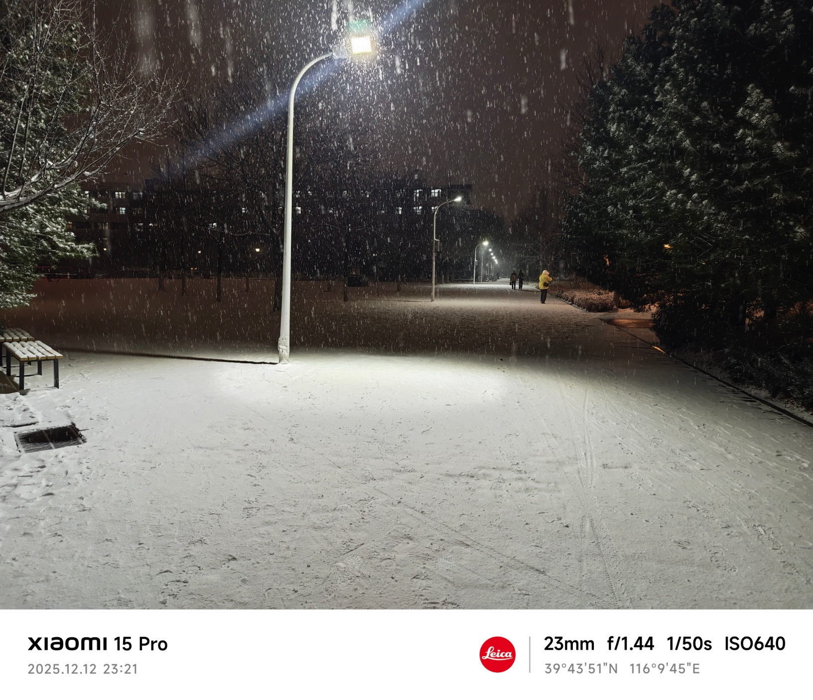
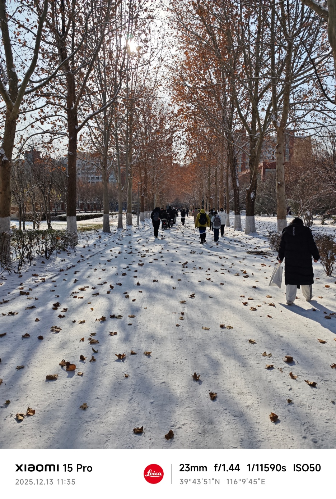
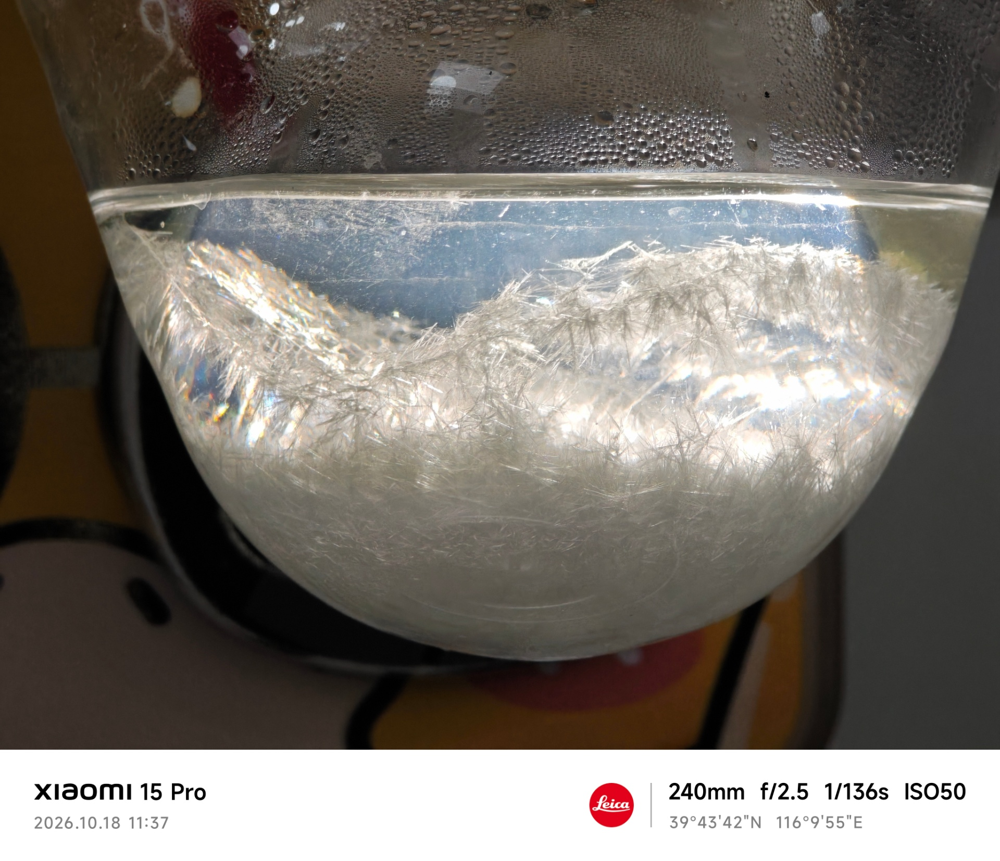
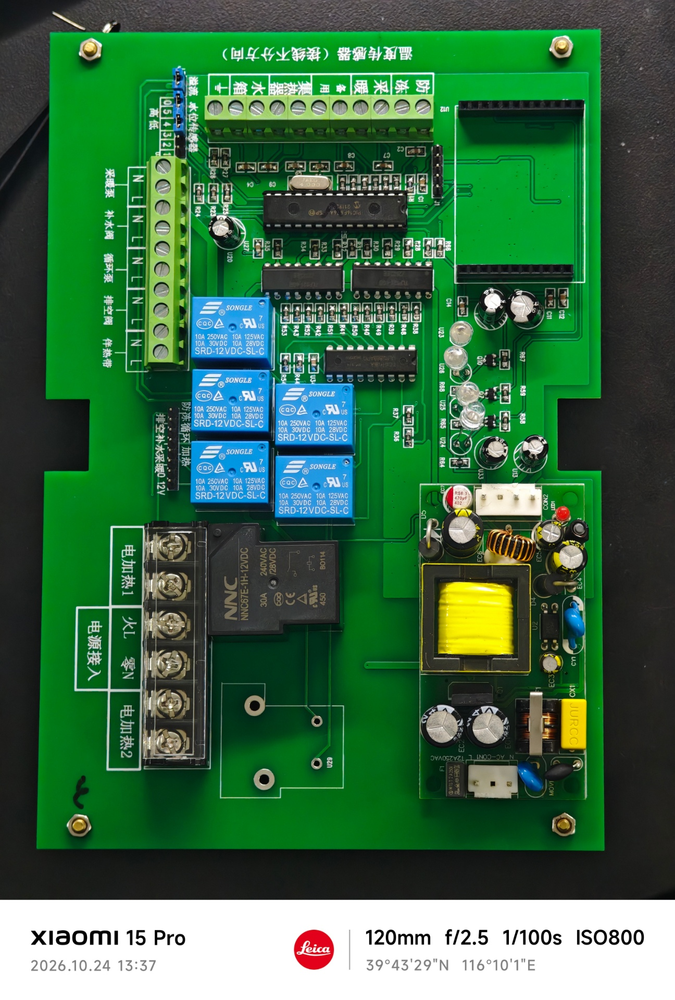
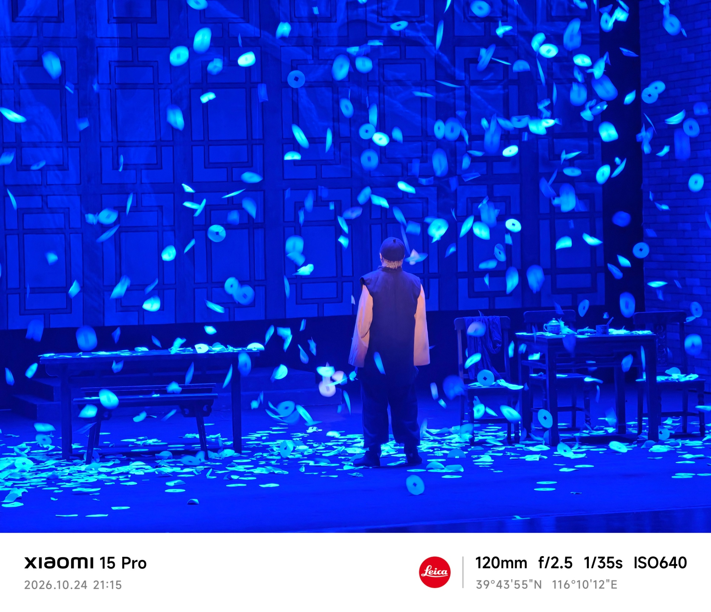
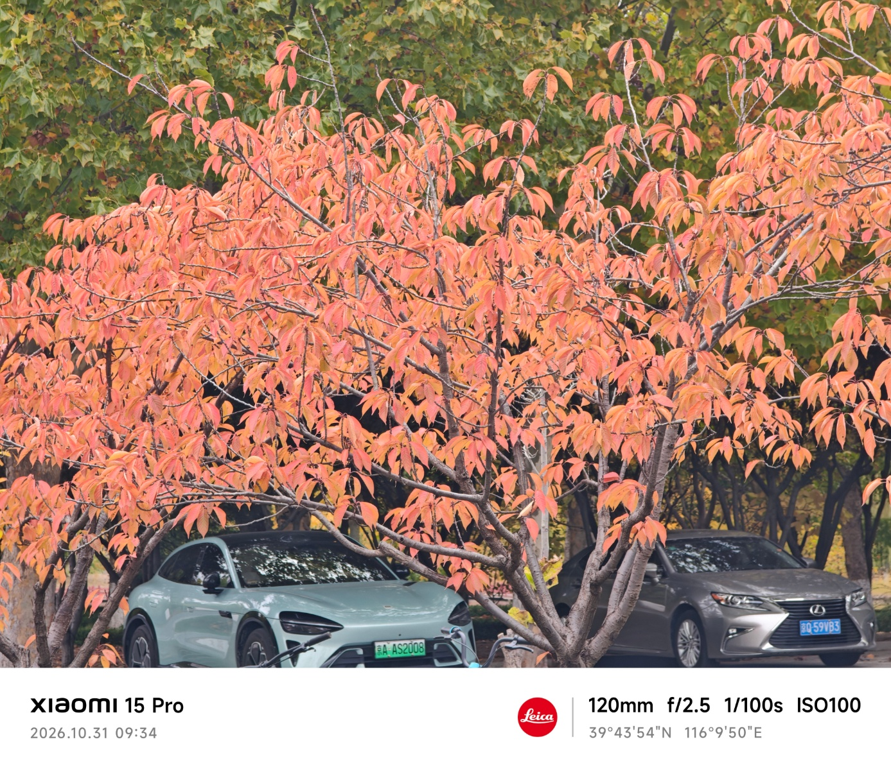

## 我渴望下雪

我渴望下雪，哪怕一点点雪花慢慢地飘下。

犹记得去年第一次下雪，是在周五上午的工数课上，雪花漫天地飞，我走在吃饭的路上，感受着一片片雪花落在身上。雪越下越大，整个世界白了，整个世界也都安静了。晚上，路灯下，能看见雪花慢慢地飘，眼前的路是那么的洁净，我慢慢地走，感受脚下雪被踩实，感受着这一难得的时光。第二天就是四级考试，路上的雪结成了冰又变成了灾难，不过考完之后又发现了一片没有变成冰的圣地之路。

  

这便是2025年冬的第一场雪，静谧，下得一点都不匆忙

## 秋天来了

今年真正感受到秋天来了是今天上午，早晨起得很早去体测，回宿舍的时候心情很好，就像一片随风慢慢飘落的雪花，想静静地看看这个校园。杨树的叶子有的变色了，有的还是绿的，旁边北湖小路上，红的，黄的，绿的树一棵接一棵，三种颜色搭配出了独属于秋天的色彩。“我是第一次来北理工的游客，我要拍照”，我嘴上嘟囔着，拿着手机开始拍，奈何确实拍不太出来（见封面图），心里头却想，我多长时间没有逛过校园了，我好像真的是第一次发自内心地想欣赏一下北湖，欣赏一下秋天的北理工。前些天只能说是感受到了温度的骤降，此时此刻，才发现了秋天的来临。

我喜欢秋天，不只是因为她不像春天那样妖娆、夏天那样灿烂，更是因为秋天结束就是冬天，而冬天——有雪。

这时候下点雪多好啊

## 十月

暑假的我疯狂地爽，九月份的我在北京疯狂地逛，十月份的我只能是不停地拆了东墙补西墙，这节课补上周的实验报告，下节课补上节课的作业，再下节课补觉，一个月没怎么休息，或者说没休息，一直在往前走，不知道为什么，不知道怎么走的。终于周五晚上，我补完了所有的作业，跟上了所有的上课进度，落笔，怅然若失，不知道该干什么，突然心里就空落落的。这个月，国奖公示，数模获奖，但是我没有一点时间去庆祝，去开心，生活的一切好像是什么都没有发生。我想，现在唯一能让我真正开心一下的，便是我走到楼下，头上突然感觉有点点凉意飘来，发现是雪花。不用很多，几片就好。

也该下点雪了

## 慢下来？

我渴望冬天的第一场雪，可以是把城市覆盖的暴风雪，但我更希望第一场就是慢慢地下，小小地下，不要影响到人们的日常生活，却带给所有人尤其是喜欢雪的人、内心焦虑浮躁的人，一些希望，一丝安静，一次慢下来的机会。那篇让本科生慢下来的文章写得很好，我很喜欢，却注定没有任何作用，但是，一场慢慢的雪却能够让人主动停下来，抬头看看天空，看看雪是怎么随风舞动，悠哉悠哉地飘下来，让这一刻——慢下来。

慢下来，像一片小小的雪花，有自己独特的结构，又能随风飘扬，即使被风吹到了地上乃至垃圾桶里，又何妨，待到化成水蒸气，又和之前一样，一样的纯洁。

但是我慢不下来，或者说不敢慢下来，我知道慢下来的生活很美好，我可能也想象不太出来慢下来之后应该干什么，就像昨天我干完所有ddl之后那样，点开文件夹，退出去，点开另一个文件夹……属于我的时间就这么一点，我不想做任何事，只能发发呆，手上做一些毫无意义的事来告诉自己现在也在忙，没有浪费时间。

我想要书中以及电影中的那种生活，傍晚，两手交叉放在后脑勺，躺在草坪上，欣赏天空，但是我想象不到日常的生活，怎么活下去呢？难道就是每天这样也不用干什么，就是欣赏美景，看看书，种种花，做做菜？好像也没有什么很特别的事情，我也能做，为什么我感受不到那种心境呢？可能因为自己完全没有了耐心，不想等待，ai降临，使得本科生不用学也能干很多研究生的活，也就是提前科研，甚至发论文，但是平心而论，我到今天所取得的这些成果奖项，除了考试，其他全是依靠甚至完全交给ai来完成的，自己什么都没有学会。也就是说我现在除了年龄阅历，其他的还是一个完完全全的高中生，只不过工具比高中生强一点。这很可怕，我不会创新，不会做科研，不会发论文，甚至都没有找到内心真正的热爱，到底我还是一个小镇做题家，那我上本科的意义是什么？

我不知道，所以我也无法让自己真正慢下来，只能是期盼着一场雪，能让我在忙碌中感受到一丝的宽慰。

——写于2026.11.1凌晨

## 附上一些图吧

  

 

